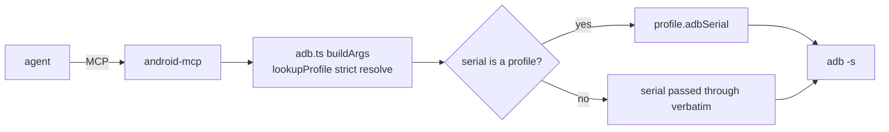

<div align="center">

# 📱 Android MCP

### ADB-driven Android control for the estate — device-first, profile-aware, read-only by default

[](LICENSE)
[](https://modelcontextprotocol.io)
[](#)
[](https://github.com/toxicwind/estate)

**See, drive, and debug any Android device over ADB — with first-class device profiles so one server targets the whole fleet.**

</div>

---

## Why this exists

The estate's Android fleet is heterogeneous: a **Hisense Android TV** and a
**Pixel 9 Pro XL**, each a different device with a different ADB target. Driving
them raw by serial is fragile (and the Pixel's ADB port *rotates* on re-pair).
`android-mcp` wraps ADB behind the Model Context Protocol and adds a **device
profile registry** — so the agent says "check the TV" or "target the Pixel",
and the server resolves the right serial automatically.

This product is a **hard fork merge** of
[`us-all/android-mcp-server`](https://github.com/us-all/android-mcp-server)
(v1.14.4) — chosen over martingeidobler and nexus-android via a trio-compare of
the candidates (the engines are near-orthogonal; see the fork decision below).

---

## ✨ Features

- **77 tools + `search-tools` meta** across device / UI / apps / logcat / files / system / shell
- **Device profiles** — each Android device is a named profile (serial, model,
  platform codename) resolved through a single strict chokepoint
- **Read-only by default** — writes need `ANDROID_MCP_ALLOW_WRITE=true`, shell
  needs `ANDROID_MCP_ALLOW_SHELL=true` (independent gates)
- **stdio + Streamable HTTP** — run locally or expose over the LAN with Bearer
  auth
- **Diagnostic depth** — logcat search/crash extraction, dumpsys
  (mem/gfx/cpu), getprop, processes, package internals

---

## 📊 Device profiles

| profile | id (serial) | model | adb target | role |
|---------|-------------|-------|-----------|------|
| `hisense-wuyishan` **(default)** | `0000dc9a7d3e0b65` | SmartTV 4K FFM | `10.0.0.225:5555` | living-room TV |
| `pixel-9-pro-xl` | `4C121FDAS0004Y` | Pixel 9 Pro XL | `10.0.0.77:36993` | hardware auth SSOT |

Select a profile:
- **Environment** — `ANDROID_PROFILE=hisense-wuyishan` (default), or
- **Per call** — pass `serial="pixel-9-pro-xl"` to any tool that takes a serial.

> 🔑 The Pixel's adb port is **volatile** (`:36993` rotates when re-paired via
> wireless debugging / Flotilla `:25245`). Update `pixel-9-pro-xl.adbSerial`
> when it changes — the profile *id* (ro.serialno `4C121FDAS0004Y`) is stable.

### How profile resolution works (the hard-merge)

Two deliberately-distinct functions in `src/profiles.ts`:

| function | behavior | used by |
|----------|----------|---------|
| `resolveProfile` | lenient — falls back to the **default** profile | active-profile accessor |
| `lookupProfile` | strict — returns `undefined` unless the key matches a profile *identity* (name/id/model/platform) | the adb chokepoint |

The adb chokepoint (`src/adb.ts` `buildArgs`) routes a tool's `serial` param
through `lookupProfile`, so **every** tool that takes `serial` becomes
profile-aware — while a raw adb address like `10.0.0.77:36993` passes through
verbatim and is **never** silently retargeted to the default device.



---

## 🚀 Quick start

```bash
pnpm install --frozen-lockfile

pnpm test           # 102 tests (vitest)
pnpm build          # tsc → dist/

# run as stdio MCP (default profile = Hisense TV)
node dist/index.js

# expose over HTTP with Bearer token
MCP_TRANSPORT=http MCP_HTTP_TOKEN=secret MCP_HTTP_PORT=37009 node dist/index.js
```

> Requires **Node 22+** (this fork is a Node-runtime product; pnpm 10 + vitest).
> ADB must be on `PATH` or set `ADB_PATH`.

---

## 🔧 Tool categories

| Category | Coverage |
|----------|----------|
| Device | list/info/properties, wireless connect/disconnect |
| Apps | install/uninstall/launch, permissions, intents, data-clear |
| UI | screenshot, UI hierarchy, tap/swipe/type/key, annotated tap |
| Logcat | capture/filter/clear/crash-extract |
| Files | list/pull/push/delete |
| System | battery/network/settings/display/wifi/notifications |
| Debug | bugreport, mem/gfx/cpu info |
| Shell | `execute-shell` (gated) |
| Meta | `list-profiles`, `search-tools` |

---

## ⚙️ Configuration

| Variable | Default | Purpose |
|----------|---------|---------|
| `ADB_PATH` | `adb` | adb binary path |
| `ANDROID_SERIAL` | profile serial | target device serial |
| `ANDROID_PROFILE` | `hisense-wuyishan` | active device profile |
| `ANDROID_MCP_ALLOW_WRITE` | `false` | enable write ops (install/tap/push) |
| `ANDROID_MCP_ALLOW_SHELL` | `false` | enable arbitrary `adb shell` |
| `ANDROID_TOOLS` / `ANDROID_DISABLE` | — | category allow/deny (token saver) |
| `MCP_TRANSPORT` | `stdio` | `http` for Streamable HTTP |
| `MCP_HTTP_TOKEN` | — | Bearer token (required for http) |

---

## 🧪 Testing

102 tests across 12 files (vitest), including the profiles hard-merge
contract (`tests/profiles.test.ts`, `tests/adb-profile.test.ts`) that pins:
- profile identities resolve to their adbSerial
- raw adb addresses are NOT profile keys (pass through, never retargeted)
- the default profile (Hisense) is index 0

```bash
pnpm test
```

---

## 🔀 Fork decision (receipt)

Chosen basis: **us-all/android-mcp-server** (76 tools, 2-tier security, stdio +
HTTP). Compared against martingeidobler (25 tools, emulator-oriented) and
nexus-android (native) with the trio compare engine — the candidates are
**near-orthogonal implementations** (token Jaccard 0.01–0.03), so the fork was
vendored wholesale and renamed, never partially merged. The compare output is
pinned in `pens/agentic-moment/products/site/compare/fixtures/android-mcp-compare.json`.

---

## 🔒 Security & license

- **Read-only by default.** Writes blocked without `ANDROID_MCP_ALLOW_WRITE=true`.
- **Shell gating separate.** `execute-shell` needs `ANDROID_MCP_ALLOW_SHELL=true`
  even with write enabled.
- **HTTP transport requires a Bearer token** (`MCP_HTTP_TOKEN`); prefers
  localhost binding.
- **License:** MIT + upstream. Forked 2026-10-31 from
  `us-all/android-mcp-server`; `@us-all/mcp-toolkit` npm dep retained (real
  runtime dependency).

---

## 📦 Source

`pens/barn/products/android-mcp/` (canonical). Registered in the estate as the
`android-mcp` MCP upstream (`thresher` → `node dist/index.js`), default profile
Hisense TV. Deploy after edits: `pnpm build && /usr/local/bin/android-mcp` →
`~/.local/bin/android-mcp` symlink.